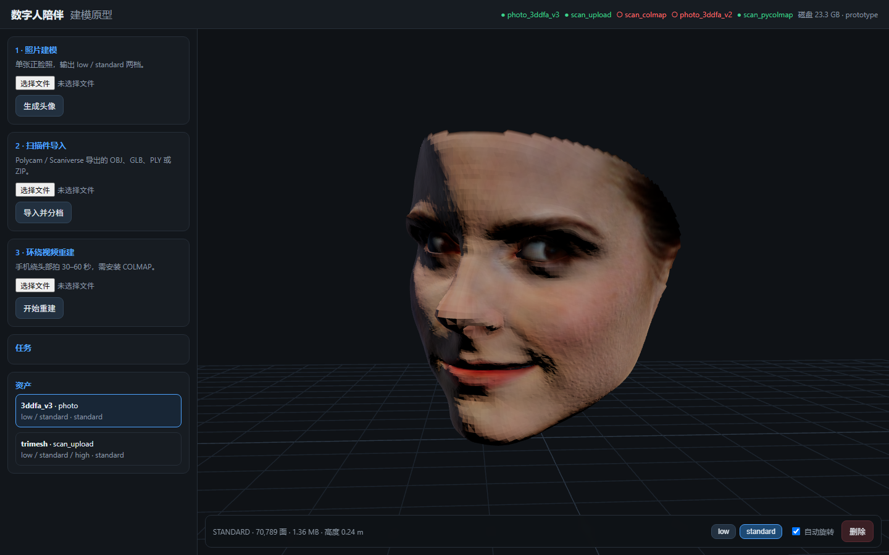

# 数字人陪伴 · 本地建模原型

用 GitHub 开源项目拼出两条「照片 / 扫描 → 3D 头像」链路，统一编译成 `low / standard / high` 三档 GLB，并带一个本地预览页。全程离线，人脸数据不出本机。



## 实测（CPU，RTX 5060 笔记本）

- 照片：`emma.jpg` → 70,789 面，全链路 **12.1 秒**，standard 1.36MB
- 扫描件：`head.glb` → 17,684 面，三档各 0.38MB
- 环绕图：24 张 800×800 → pycolmap 注册 17 张 / 587 点 → 6,102 面，**5.9 秒**（预览级）

## 当前能力

| 链路 | 引擎 | 状态 | 输出 |
|---|---|---|---|
| 单张照片 | [3DDFA-V3](https://github.com/wang-zidu/3DDFA-V3)（MIT） | 可用，CPU 约 12s | 带顶点色的头部网格，low/standard |
| 扫描件上传 | trimesh（MIT） | 可用 | OBJ/GLB/PLY/STL/ZIP，low/standard/high |
| 环绕视频 | COLMAP 4.2.1（已安装）+ pycolmap 回退 + Open3D | 可用，快速模式为预览级 | 稠密网格，low/standard/high |
| 照片回退 | [3DDFA_V2](https://github.com/cleardusk/3DDFA_V2)（MIT） | 代码就绪，缺 FaceBoxes 权重 | 低模 |

## 架构

```
web (three.js) ──HTTP── FastAPI ── SQLite 队列 ── worker
                                                ├─ photo_3ddfa_v3 → OBJ(顶点色)
                                                ├─ scan_upload     → OBJ/GLB
                                                ├─ scan_colmap     → PLY（需 COLMAP 二进制）
                                                └─ scan_pycolmap   → PLY（pip 版，子进程隔离）
                                                          ↓
                                             compiler：归一化 / 减面 / GLB
                                                          ↓
                                      data/avatars/<id>/{low,standard,high}.glb
```

## 快速开始

```powershell
# 1. Python 3.10 环境
py -3.13 -m pip install uv
py -3.13 -m uv venv --python 3.10 .venv
py -3.13 -m uv pip install --python .venv\Scripts\python.exe -r requirements.txt `
  --index-url https://pypi.tuna.tsinghua.edu.cn/simple

# 2. 照片引擎
git clone --depth 1 https://github.com/wang-zidu/3DDFA-V3 engines/3ddfa_v3
git -C engines/3ddfa_v3 apply ../patches/3ddfa_v3.patch
.venv\Scripts\python.exe tools/fetch_weights.py
cd engines\3ddfa_v3\util\cython_renderer
..\..\..\..\.venv\Scripts\python.exe setup.py build_ext -i
cd ..\..\..\..

# 3. 前端
cd web
npm install --registry=https://registry.npmmirror.com
npm run build
cd ..

# 4. 启动
.venv\Scripts\python.exe -m app.cli serve --port 8000
# 打开 http://127.0.0.1:8000
```

COLMAP 4.2.1 已解压到 `engines/colmap/`；也可设置 `COLMAP_BIN` 指向自己的 `colmap.exe`。扫描视频时按 `COLMAP → pycolmap` 顺序回退，后者无需二进制即可跑快速模式（稀疏点云 + Poisson，预览级）。

## 命令行

```powershell
python -m app.cli doctor                 # 引擎可用性、磁盘、许可证
python -m app.cli photo 照片.jpg          # 直接出资产
python -m app.cli scan  扫描件.glb        # 或 .obj/.ply/.zip
python -m app.cli scan  环绕视频.mp4      # 需要 COLMAP
python -m app.cli serve --port 8000
```

## API

| 方法 | 路径 | 说明 |
|---|---|---|
| POST | `/api/jobs` | multipart：`kind=photo\|scan_upload\|scan_video` + `files` |
| GET | `/api/jobs/{id}` | 状态、阶段、错误 |
| GET | `/api/jobs/{id}/log` | 引擎原始日志 |
| POST | `/api/jobs/{id}/cancel` | 取消 |
| GET | `/api/avatars` | 资产列表 |
| GET | `/api/avatars/{id}` | meta.json |
| DELETE | `/api/avatars/{id}` | 删除资产 |
| GET | `/api/capabilities` | 引擎可用性与许可证 |

## 资产格式

```json
{
  "schema_version": 1,
  "avatar_id": "av_...",
  "source": {"kind": "photo", "engine": "3ddfa_v3"},
  "tiers": {"low": {"file": "low.glb", "tris": 20000, "bytes": 390000}},
  "bounds": {"min": [-0.13, 0, -0.08], "max": [0.13, 0.24, 0.08]},
  "up_axis": "Y", "forward": "-Z", "units": "meter",
  "height_m": 0.24,
  "quality": "standard",
  "licenses": ["MIT"]
}
```

## 目录

```
app/            服务、任务队列、适配器、编译器
  adapters/     第三方引擎适配器 + manifest.json（许可证闸门）
  compile/      归一化、减面、GLB 导出
web/            Vite + three.js 预览页
engines/        第三方仓库/二进制（gitignore）
  patches/      引擎补丁与重放说明
tools/          权重下载
tests/          编译与适配器测试
docs/           选型实测、许可证
data/           上传、临时、资产（gitignore）
```

## 已知限制

- 照片链路输出的是**开放曲面**（无后脑），预览用双面渲染；做产品需要补后脑或换高斯方案。
- 照片纹理是**逐顶点颜色**，近看偏糊；下一步可烘焙 1K/2K 贴图。
- 扫描件统一按 0.24m 头高归一化，全身扫描会被缩小。
- 尚无骨骼、blendshape、口型；这是第二期的内容。
- `low/standard/high` 在源网格面数不足时会出现三档相同（记录实际面数）。

## 许可证

原型默认 `COMPANION_PROFILE=prototype`，允许非商用引擎；设为 `commercial` 时注册表会过滤掉 `commercial_ok=false` 的组件。详见 [docs/licenses.md](docs/licenses.md)。
